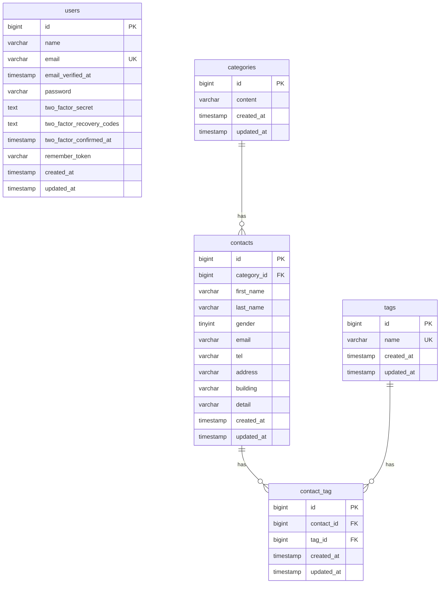

# COACHTECH お問い合わせフォーム

## 概要

Laravel 10を使用したお問い合わせ管理アプリケーションです。

利用者はお問い合わせの入力・確認・送信ができます。
管理者はログイン後、お問い合わせの検索・詳細確認・削除・CSVエクスポートを行えます。

### 主な機能

- お問い合わせフォーム（入力・確認・送信）
- バリデーションと日本語エラーメッセージ
- カテゴリー選択・タグの複数選択
- ユーザー登録・ログイン
- 管理画面でのお問い合わせ検索・詳細確認・削除
- タグ管理（登録・編集・削除）
- CSVエクスポート
- REST APIによるお問い合わせの取得・登録・更新・削除

## 使用技術

| 技術 | バージョン・構成 |
| --- | --- |
| PHP | 8.5（Laravel Sailの実行環境） |
| Laravel | 10.50.3 |
| MySQL | 8.4 |
| Node.js | 24.15.0（Docker内） |
| npm | 11.14.1（Docker内） |
| Vite | 5系 |
| Tailwind CSS | 3系 |
| Alpine.js | 3系 |
| Docker | Laravel Sail |
| phpMyAdmin | Docker Compose |

## 環境構築

### 前提条件

- Git
- Docker Desktop
- Composer（初回の依存関係インストールに使用）

### 1. リポジトリを取得

```bash
git clone <リポジトリURL>
cd contact-form-app
```

### 2. PHPの依存関係をインストール

```bash
composer install
```

ホスト側にComposerがない場合は、Composerの公式Dockerイメージなどを使用して依存関係をインストールしてください。

### 3. 環境変数を設定

```bash
cp .env.example .env
```

`.env` のデータベース設定を確認してください。

```env
DB_CONNECTION=mysql
DB_HOST=mysql
DB_PORT=3306
DB_DATABASE=laravel
DB_USERNAME=sail
```

`DB_PASSWORD` はDocker ComposeのMySQL設定と一致させてください。

### 4. Dockerコンテナを起動

```bash
./vendor/bin/sail up -d
```

### 5. アプリケーションキーを生成

```bash
./vendor/bin/sail artisan key:generate
```

### 6. マイグレーションと初期データ登録

```bash
./vendor/bin/sail artisan migrate --seed
```

初期データとして、管理画面確認用ユーザー、カテゴリー5種類、タグ5種類、お問い合わせサンプル20件を登録します。

### 7. フロントエンドの依存関係をインストール

```bash
./vendor/bin/sail npm ci
```

### 8. Viteを起動

```bash
./vendor/bin/sail npm run dev
```

## 開発環境URL

| 用途 | URL |
| --- | --- |
| お問い合わせフォーム | http://localhost |
| ユーザー登録 | http://localhost/register |
| ログイン | http://localhost/login |
| 管理画面 | http://localhost/admin |
| phpMyAdmin | http://localhost:8080 |

ポート番号は環境変数の設定によって変更できます。

## 開発用テストアカウント

- メールアドレス：`test@example.com`
- パスワード：`password`

このアカウントは開発・動作確認専用です。本番環境では使用しないでください。

## ER図



`contacts` と `tags` は、`contact_tag` を介した多対多の関係です。

`contact_tag` には `contact_id` と `tag_id` の組み合わせに一意制約があります。

`users` は認証用の独立したテーブルです。

## APIエンドポイント

ベースURL：`http://localhost/api/v1`

| メソッド | パス | 概要 |
| --- | --- | --- |
| GET | `/contacts` | お問い合わせ一覧取得 |
| GET | `/contacts/{contact}` | お問い合わせ詳細取得 |
| POST | `/contacts` | お問い合わせ新規登録 |
| PUT | `/contacts/{contact}` | お問い合わせ更新 |
| DELETE | `/contacts/{contact}` | お問い合わせ削除 |

## テスト

テスト用データベース `testing` を使用します。

```bash
./vendor/bin/sail exec -e APP_ENV=testing -e DB_DATABASE=testing laravel.test php artisan test
```

最終確認時の結果：72テスト成功、184アサーション。

## 作成者

宮崎 新也
